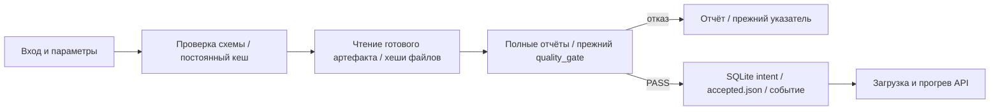
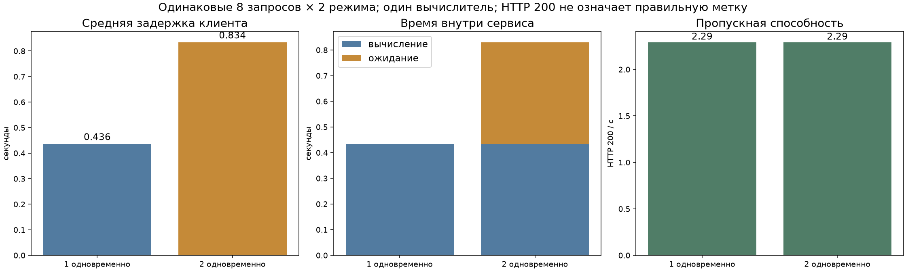

# ДЗ8+9+10 — процесс выпуска и настоящий API

## 1. Код и исходные условия

[Репозиторий](https://github.com/Rcinderblock/bmstu-mlops), исходный прототип `0f1fce9`, исправленная реализация `55e044d8400e8c43d9fa4c00bbd101d021faac3d`. [Полный diff](results/hw8910/fixes.patch), [семь причин](../defects.csv). Устройство: Apple M3, 16 ГиБ, mps, bfloat16; Python 3.12.12. Prefect 3.8.8, FastAPI 0.139.0, uvicorn 0.54.0. Torch/Transformers/PEFT закреплены в manifest и uv.lock. Совместимые версии проверены запуском; более новый FastAPI 0.161.1 оказался несовместим с Body(min_items) в этом Prefect, поэтому выбран и закреплён 0.139.0 без правки сторонних библиотек.

## 2. Семь причин и собственные проверки

| № | Причина | Исправление |
|---|---|---|
| 1 | Ключ хешировал только путь | SHA-256 входа и всех параметров плюс версия обработки; постоянный результат |
| 2 | Проверка истинности вместо полного контракта и связанного допуска | Строгий контракт и повторный вызов прежнего quality_gate по проверенным полным отчётам |
| 3 | Прямая перезапись accepted.json | Временный файл рядом, flush/fsync, os.replace, уборка при ошибке |
| 4 | Безусловный append без устойчивого release_id | SQLite: уникальный release_id и pending/committed; восстановление JSONL-проекции |
| 5 | ready=True до загрузки/прогрева | Фоновая загрузка и настоящий прогрев; независимые health/ready |
| 6 | Чтение указателя при каждом ответе | ID/runtime из загруженного backend; управляемый перезапуск и проверенный откат |
| 7 | Нет строгой валидации до вычисления | Строгие типы, длина, фиксированный оценённый лимит до вызова backend |

| Проверка | До | После |
|---|---|---|
| test_cache_recovery_and_changed_bytes_in_new_process | FAIL | ok |
| test_incomplete_and_foreign_reports_preserve_pointer | FAIL | ok |
| test_atomic_failure_preserves_real_file_bytes | FAIL | ok |
| test_identical_publication_and_repair_after_pointer_crash | FAIL | ok |
| test_http_readiness_waits_for_warmup | FAIL | ok |
| test_http_identity_restart_and_rollback | FAIL | ok |
| test_http_validation_does_not_call_backend | FAIL | ok |

В собственном наборе три настоящих HTTP-опыта, три опыта с отдельными процессами и ещё один с реальным файлом и mock ошибки os.replace. Всего 7, из них 6 интеграционных, сверх 13 приложенных. На прототипе все семь дают FAIL из-за наблюдаемого неверного поведения; ошибки импорта/неизвестные команды не засчитываются. В тесте дубликатов исходник падает на двух событиях до дополнительной точки сбоя; в тесте версий — на ложном ID до дополнительной команды отката. [До](results/hw8910/tests-integration-before.txt), [после](results/hw8910/tests-fast-after.txt), подробные пары журналов [before](results/hw8910/before) / [after](results/hw8910/after).

Приложенный test_release.py побайтно совпадает с оригиналом. Отпечаток по имени и содержимому **09bd65e6b886**, SHA-256 файла 03632e58fa10f8742a205ae04ecba956f7a7cd0a0cfb90fc7fa9d32d6f2c1d7e. Прежние проверки сохранены: 32 проверки оценки и 40 модульных прошли отдельно. Историческая техническая приёмка обучения относится к своему старому коммиту; она не объявляется заново пройденной на расширенном src/.

## 3. Что переиспользовано

Читается готовый run `e4f47194810e4c4daa7826b58f8fd88d`, версия `models:/planner-qwen-adapter/1`; повторного sweep/обучения нет. Полная оценка — `14364972e4be484e988fd9691fdd036f`, 54 golden + 5 behavioral. [Origin](results/hw8910/origin.json) связывает артефакт, зафиксированные версии библиотек и исходный Git-коммит. Хеш обучавшего кода проверен по историческому коммиту, а не по новым модулям API.

Принятая версия — исходная `Qwen/Qwen3-0.6B`, revision c1899de289a04d12100db370d81485cdf75e47ca, model_id `planner-baseline-c1899de289a0`. Она не обучалась нами: её веса получены из закреплённого источника Hugging Face. Поле source_training_run_id связывает общее описание базы с обучающим опытом, а не приписывает baseline локальное обучение. Кандидат остаётся отклонённым: 21/54 против 27/54 у базы. Registry alias champion не менялся; accepted.json — отдельный локальный указатель.

## 4. Граф, входы и восстановление



Четыре отдельные задачи в `src/release_flow.py`; между ними передаются описания URI/run ID/хешей, не веса или тензоры. Задача подготовки действительно читает и проверяет 54 JSONL-вопроса. Ключ включает SHA-256 байтов, tokenizer_revision, template_sha256, max_length, code_revision и фактический SHA кода обработки. Порядок dict и путь не заменяют содержимое. Prefect добавляет отдельное пространство хранения workspace, чтобы не ссылаться на уже удалённый каталог чужого опыта. Результаты — JSON в cache/ и .prefect-results/. [Настройки задач и постоянных результатов](https://reference.prefect.io/prefect/tasks/) соответствуют использованному интерфейсу.

| Опыт | Exit | Подготовка | Прежний указатель при отказе |
|---|---|---|---|
| 01-fail-after-prepare | 1 | PREPARED | да |
| 02-resume-new-process | 0 | CACHE_HIT | — |
| 03-idempotent-repeat | 0 | CACHE_HIT | — |
| 04-change-input-same-path | 1 | PREPARED | да |
| 05-candidate-quality-rejection | 1 | CACHE_HIT | да |
| 06-incomplete | 1 | CACHE_HIT | да |
| 07-truthy-string | 1 | CACHE_HIT | да |
| 08-foreign | 1 | CACHE_HIT | да |
| 09-nan | 1 | CACHE_HIT | да |

[Команды, exit codes, run IDs и SHA до/после](results/hw8910/flow-experiments/results.json), [все состояния задач](results/hw8910/attempts.jsonl). После управляемого сбоя следующий процесс получает Cached. Изменённые байты по тому же пути вызывают новую подготовку; изменённый смысл golden дополнительно отклоняется как несовместимый со старой оценкой. Временная ConnectionError/TimeoutError при чтении артефакта допускает максимум два повтора; неверная схема, веса и отказ gate не повторяются.

## 5. Публикация и согласованность

accepted.json пишется временным файлом в той же папке, flush/fsync выполняются до os.replace, при ошибке temp удаляется. Отказ не вызывает замену указателя. Во всех реальных отрицательных опытах SHA до и после одинаков: `fe713a8644049fc354fc944fb86654d0b39d307d8d0fc8c1e345af30cfa8a619`.

SQLite — первичный журнал уникальных выпусков. release_id учитывает model_id, model_sha256, runtime_sha256 и SHA связанного решения. До замены указателя сохраняется pending intent; после — committed. При сбое между ними повтор сверяет указатель с intent и завершает событие. publications.jsonl — восстанавливаемая проекция SQLite. attempts.jsonl хранит все попытки и состояния задач отдельно. [Реальный журнал](results/hw8910/publications.jsonl) содержит одно событие, хотя успешный выпуск повторялся в другом процессе. [Опыт сбоя/восстановления STUB](results/hw8910/after/test_identical_publication_and_repair_after_pointer_crash.jsonl) подтверждает отсутствие двойного события. Это не распределённая транзакция и не защита от нескольких писателей или всех вариантов потери питания.

## 6. Полный gate и привязка runtime

[Manifest базы](results/hw8910/manifest-baseline.json), [кандидата](results/hw8910/manifest-candidate.json), [решение базы](results/hw8910/release-report-baseline.json), [отказ кандидата](results/hw8910/release-report-candidate.json). Обвязка сверяет SHA полных исходных отчётов и сырых ответов, заново пересчитывает per-item/срезы/behavioral, вызывает неизменённое правило качества. PASS не записывается вручную и не заменяется одним val_loss. Для сохранения baseline правило сравнивает её полную оценку с ней же; это сохранение принятой исходной версии, не заявление об улучшении.

Runtime фиксирует точную базу, токенизатор, шаблон, instruction, seed, do_sample=False, thinking=False, лимит 32, bfloat16, MPS и версии библиотек генератора. Экспорт шаблона из tokenizer_config в отдельный файл не изменил ни одного из 59 текстов чата или наборов token IDs — [проверка](results/hw8910/tokenizer-equivalence.json). Условия генерации остались прежними, поэтому новая полная генерация не требовалась. Хеши фактических файлов пересчитываются перед публикацией и перед загрузкой; runtime_sha256 пересчитывается из всего словаря. Неполный/чужой отчёт, строковый PASS, NaN и ошибка замены имеют отдельные доказательства. STUB ONLY явно синтетичен и не считается настоящей оценкой.

## 7. Быстрый запуск и намеренная поломка

`make check` запускает 20 проверок. Изолированный fast-env создан из requirements-fast.txt: в нём отсутствуют torch, transformers, mlflow и веса; при этом HTTP, файловая система, Prefect и subprocess настоящие. `make check-negative` запускает те же контрактные проверки на временной копии с намеренно испорченным cache_key и возвращает ненулевой код; рабочий файл не изменён. [Журнал поломки](results/hw8910/tests-intentional-failure.txt). Исходники восстановлены, зелёный набор прошёл. Проверки выполнены локально; удалённый Actions-run и защита merge не заявляются.

| Событие | Действие и команды |
|---|---|
| Код HTTP/процесса без изменения генерации | make check; make check-eval. Обучение и полная оценка не нужны. |
| Изменение инструкции/декодирования | Синхронизировать контракт API и evaluation/params.json; make check; make release-reevaluate; создать новый workspace через src.release_bridge. До новой оценки старый допуск не действует. |
| Новые данные обучения | uv run dvc repro tokenize; проверить схему/пересечения. При изменении обучающих примеров нужно новое обучение, затем полная оценка. |
| Новый golden | Подготовить проверенный набор и полный индекс; uv run dvc repro eval_data; make release-reevaluate. Изменение только golden не требует обучения прежних весов. |
| Новый адаптер | Закрепить его URI/version/run_id в metrics/candidate-model.json после проверки training run; make release-reevaluate; новый src.release_bridge workspace; lab.py run с manifest-candidate.json. |

При смене модели/данных/условий нужны новые отчёты и новый workspace. Например: `make release-reevaluate`, затем `uv run python -m src.release_bridge --workspace deployments/new --reports-dir metrics` и `uv run python lab.py --workspace deployments/new run --manifest manifest-candidate.json --report release-report-candidate.json`. Изменение поддерживаемого лимита требует согласованно изменить контракт API и тесты; произвольный параметр запроса не наследует старый допуск. Полная оценка — генерация модели, а не быстрый CI.

## 8. Настоящий API

Ресурсы загружаются один раз в управляемом [lifespan FastAPI](https://fastapi.tiangolo.com/advanced/events/). Фоновая загрузка проверяет связанный отчёт и файлы, затем загружает Transformers/PEFT и делает настоящее вычисление для прогрева. До этого ready и generate возвращают 503; health подтверждает только жизнь процесса. Валидация ограничивает длину и строгие типы, допускается только оценённый лимит 32. Одновременных вычислений максимум одно. /debug включён только для STUB или явного локального --debug.

| Событие | HTTP | Фактическая версия |
|---|---|---|
| initial-health | 200 | — |
| initial-not-ready | 503 | — |
| initial-ready | 200 | planner-baseline-c1899de289a0 |
| restart-ready | 200 | planner-baseline-c1899de289a0 |
| restart-real-smoke | 200 | planner-baseline-c1899de289a0 |

Настоящий ответ на «поставь будильник на семь утра»:

```json
{
  "answer": "{\"answer\": \"alarm_set\"}",
  "output_tokens": 8,
  "input_tokens": 261,
  "generation_seconds": 0.40936333301942796,
  "model_id": "planner-baseline-c1899de289a0",
  "runtime_sha256": "1c6c5cd2f5c9a3688e81cc8a55b4e251975b93fcc1c1b0649c6d6ed38e4a49c4",
  "request_id": "7bfdf05b-58a8-4cdc-b6fd-1d6318f63b68",
  "queue_seconds": 1.2208009138703346e-05,
  "service_seconds": 0.4126095420215279,
  "backend": "transformers"
}
```

[Полная последовательность жизни, неверных запросов и повторной загрузки](results/hw8910/api/lifecycle.json). Неверные запросы получили 422, вызовов генератора до/после 0/0. Это ответ Transformers, не STUB. После перезапуска загружена та же принятая версия с тем же runtime_sha256.

## 9. Загрузка версии и откат

[Отдельный HTTP-опыт A → B → A](results/hw8910/after/test_http_identity_restart_and_rollback.jsonl) использует две лёгкие STUB-версии, настоящие процессы и реальные файлы. Публикация B не меняет загруженную A; перезапуск загружает B. Откат разрешён только к ранее принятой A с проверенным отчётом; до перезапуска память остаётся B, затем ответ снова A. Это инженерный опыт, не новая настоящая модель. Реальная загрузка baseline доказана отдельно выше.

## 10. Замер 8+8

| Параллельность | n | HTTP 200 | Ошибок | Весь пакет, с | HTTP 200/с | Средняя, с | Максимальная, с | Очередь, с | Вычисление, с | Выходных токенов |
|---|---|---|---|---|---|---|---|---|---|---|
| 1 | 8 | 8 | 0 | 3.490 | 2.292 | 0.436 | 0.977 | 0.000 | 0.434 | 94 |
| 2 | 8 | 8 | 0 | 3.491 | 2.291 | 0.834 | 1.293 | 0.395 | 0.434 | 94 |

[Все 16 попыток CSV](load-results.csv), [неизменённые ответы JSONL](results/hw8910/api/attempts.jsonl), [сырые итоги](results/hw8910/api/summary.json). Один и тот же набор, лимит 32, настоящий прогрев, одинаковые model_id/runtime и даже тексты/число токенов в двух режимах. Ошибки/тайм-ауты сохраняются; в этом запуске их не было, поэтому задержки ошибок обозначены null, а не выдуманным нулём. Успех в таблице означает **HTTP 200**, не правильную метку. Например, alarm-query получил обрезанный ответ в 32 токена, calendar-query — ошибочную alarm_query. Качество не маскируется транспортной успешностью.



Последовательный вычислитель объясняет почти неизменные 2.29 запроса/с и рост клиентской задержки: примерно 0.395 с среднего ожидания добавляются к 0.434 с вычисления. Клиентская задержка дополнительно включает HTTP, сериализацию и планирование потоков. Приведены средняя и максимум, не устойчивый p95. Один пакет и один прогрев не изолируют шум ОС, кэш и форму запросов; статистическая значимость не заявляется.

Prefill обрабатывает входную последовательность, decode добавляет токены последовательно. KV-cache хранит ключи/значения внимания уже обработанных токенов; размер растёт с контекстом и числом одновременно вычисляемых последовательностей. Для конфигурации этой модели теоретически 114,688 байт на токен/последовательность в bfloat16, без служебных расходов; это расчёт по config.json, не измеренный максимум. Очередь HTTP не равна батчу вычислений. Ответ отдаётся одним JSON, поэтому TTFT и ITL не измерены. Этот Transformers-сервис с semaphore=1 не проверяет преимущества планировщиков, совместных батчей и управления памятью SGLang/vLLM.

## 11. Доступ и видео

На GitHub — код, настройки, тесты, отчёты и маленькие журналы. Веса/окружения/кеши/тома/лекции/голос исключены. [Текстовые входы и доказательства](https://github.com/Rcinderblock/bmstu-mlops/releases/tag/release-inputs-v1) публикуются отдельно с закреплённым SHA-256. `make release-restore` восстанавливает их и скачивает принятую базу из Hugging Face по точной revision, проверяя фактические хеши. Доступ к исходным полным отчётам также есть в docs/results/hw67/. Веса отклонённого адаптера в приложение не включаются и для обслуживания baseline не нужны; локальные опыты кандидата используют сохранённый MLflow-артефакт.

Готово одно видео 7:33 (453.1 с), 1920×1080, H.264/AAC, 13 глав. Это обзор настоящих результатов с локально синтезированной озвучкой по разрешённому образцу пользователя. Полное чтение декодером без ошибок; длительности звука и изображения совпадают. Проверены заключительная речь, пауза и затемнение до чёрного. [Проверки файла](results/hw8910/video-quality.json). Видео передаётся отдельно от Git. Локальная памятка для отправки — notes/submission/hw08-09-10/README.md. Паузы выполнения тестов в обзоре частично сокращены; [полные журналы команд записи](results/hw8910/screen-demo/) сохранены.

Проверка доступа после публикации: текстовое приложение скачано без авторизации из GitHub Release, SHA совпал. В новом каталоге восстановлены точные файлы базы из локального HF-кеша, проверены их SHA и связь полного отчёта: [результат](results/hw8910/public-restore.json), [вывод](results/hw8910/public-restore.log). Загрузка больших весов по сети повторно не проверялась.
